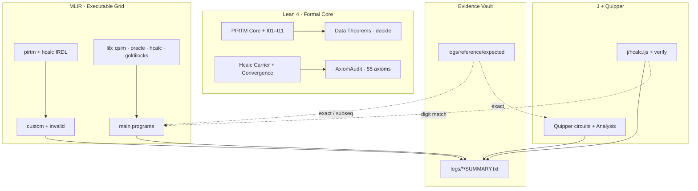

<!--
  SPDX-License-Identifier: AGPL-3.0-only
  Also licensed under the SnapKitty Opaque License (LicenseRef-SnapKitty-Opaque-1.0); see README.md.
  Copyright (C) 2026 Ahmad Parr
-->

# pirtm-hcalc

[](https://github.com/AHMADALIPARR/pirtm-hcalc/actions/workflows/ci.yml)
[](https://lean-lang.org/)
[](LICENSE)
[](logs/SUMMARY.txt)
[](GAPS.md)
[](logs/lean/SUMMARY.txt)

```
╔══════════════════════════════════════════════════════════════════════════════╗
║  ▓▓▓ PIRTM-HCALC  ·  NEON GRID  ·  VERIFIED STACK  ·  2048 AMPLITUDES ▓▓▓   ║
║                                                                              ║
║     11-qubit state-vector  ×  nested contraction recurrence  ×  Goldilocks  ║
║     Lean proofs  ·  MLIR IRDL dialects  ·  J core  ·  Quipper circuits      ║
║                                                                              ║
║     THINK BELOW THE ABSTRACTION.  VERIFY ABOVE THE ASSUMPTION.               ║
║     OWN THE ENTIRE STACK.                                                    ║
╚══════════════════════════════════════════════════════════════════════════════╝
```

This is the home of two former projects, merged into one self-contained Lake project:

* **PIRTM**: an 11-qubit state-vector model (2048 amplitudes) and an adversarial
  "restricted observer" experiment. It also includes a content-addressed store
  and retrieval oracle, a bounded recursive hypothesis engine, eleven worker
  agents with a scheduler, and the formal invariants I01–I11.
* **HCALC**: a nested contraction recurrence
  `X_{t+1} = Ξ(t, Λm · C(Tp(X_t)))` on a finite real carrier, together with its
  definitions (`spec/PRODUCTION.md`), its relational model, its Lean library,
  its J core and its J verification harness. The Goldilocks field
  (p = 2^64 − 2^32 + 1) is also here.

The project uses only these languages:

* **Lean 4**: proofs, the experiment data as theorems, and the build/run driver (`lakefile.lean`).
* **MLIR**: custom IRDL dialects plus executable programs, lowered to LLVM and run.
* **J**: the HCALC core and its verification harness.
* **Quipper (Haskell)**: the quantum circuits.

---

## Signal // Noise — What Lives in the Grid

```
                    ┌─────────────────────────────────────┐
                    │         LAKE DRIVER                 │
                    │   lakefile.lean  ·  scripts: all    │
                    └──────────────┬──────────────────────┘
           ┌───────────────────────┼───────────────────────┐
           ▼                       ▼                       ▼
    ┌──────────────┐       ┌──────────────┐       ┌──────────────┐
    │   LEAN 4     │       │    MLIR      │       │   QUIPPER    │
    │  proofs +    │       │  IRDL + run  │       │  circuits +  │
    │  data thms   │       │  vs refs     │       │  sim         │
    └──────┬───────┘       └──────┬───────┘       └──────┬───────┘
           │                      │                      │
           ▼                      ▼                      ▼
    ┌──────────────┐       ┌──────────────┐       ┌──────────────┐
    │  J HCALC     │◄──────│  Goldilocks  │       │  logs/       │
    │  core+verify │       │  + pipeline  │       │  reference/  │
    └──────────────┘       └──────────────┘       └──────────────┘
```

In the neon undercity of formal methods, this repo is a sealed vault: every numeric line that leaves an MLIR program or a Quipper simulation is compared, bit-for-bit or as an ordered subsequence, against the original Python oracle captures stored under `logs/reference/expected/`. The J core and the MLIR HCALC/Goldilocks ports must agree digit-for-digit on the same printed sections. Lean never uses `sorry`, `admit`, or `native_decide`; the 55 project axioms are confined to the HCALC Real stub and Foundry layer and are audited on every `lake script run lean`. The Alloy models of both original projects have been ported to Lean theorems that quantify over all finite instances rather than a bounded scope, exposing the classic vacuity critique as machine-checked facts.

The architecture is deliberately multi-paradigm. Quantum amplitudes live as perfect binary trees of Gaussian integers over powers of √2 in `PirtmHcalc/Quantum/Exact.lean`. The same circuits are expressed in Quipper, simulated, and gate-counted. The same experiments appear as executable MLIR that lowers through custom IRDL dialects (`pirtm` and `hcalc`) into LLVM and runs under `mlir-cpu-runner`. HCALC’s nested contraction is defined in `spec/PRODUCTION.md`, implemented in pure J (`j/hcalc.ijs` + helpers), re-implemented in MLIR, and axiomatised for convergence theorems in the Lean Hcalc library. Nothing is allowed to drift: the Lake scripts enforce the cross-language contracts and write the evidence into `logs/`.

---

## Layout

| Path | Contents |
|---|---|
| `PIRTM/`, `PIRTM.lean` | PIRTM Lean library (core definitions, invariants, 11-coordinate model) |
| `Hcalc/`, `Hcalc.lean` | HCALC Lean library (carrier, Tp, C, Λm, Ξ, pipeline, convergence, Foundry layer, Real stub) |
| `PirtmHcalc/Agda/` | the PIRTM Agda development ported to Lean (Core, Assumptions, Invariants I01–I11) |
| `PirtmHcalc/Alloy/` | every Alloy model of both projects ported to Lean (`Hcalc`, `HcalcMirror`, `VacuityDemo`), including the vacuity analysis |
| `PirtmHcalc/Quantum/Exact.lean` | exact state-vector semantics over ℤ[i]/√2^k (perfect binary tree of amplitudes) |
| `PirtmHcalc/Data/` | experiment results as theorems proved by computation (`decide`) |
| `tools/AxiomAudit.lean` | lists every axiom declared in the project and the axioms each theorem uses |
| `mlir/dialects/` | IRDL definitions of the custom `pirtm` and `hcalc` dialects |
| `mlir/lib/` | MLIR libraries: I/O and number formatting, SHA-256, state-vector simulator, matrix circuits, CAS/oracle, HCALC, Goldilocks |
| `mlir/main/` | executable MLIR programs (one per experiment / test suite) |
| `mlir/custom/` | programs written with the custom dialect ops (IRDL-verified, lowered, run); `invalid/` holds programs the verifier must reject |
| `quipper/` | Quipper circuits for every PIRTM circuit, with a simulator and printed circuits |
| `j/` | HCALC J core (`hcalc.ijs`), its spectral helpers (`cite.ijs`), Goldilocks (`goldilocks.ijs`), demo |
| `verify/` | J verification harness (H-* properties, fail-open) |
| `spec/PRODUCTION.md` | the HCALC definitions document (the J harness reads it) |
| `logs/` | output of the last runs; `logs/reference/` holds reference outputs captured from the original Python |

### Path Deep-Dive — Circuitry of the Vault

```
pirtm-hcalc/
├── PIRTM/                  # pure Lean 11-qubit + invariants I01–I11
│   ├── Core.lean
│   ├── Invariants.lean
│   └── Quantum11.lean
├── Hcalc/                  # nested contraction + Real/Foundry axioms
│   ├── Axioms.lean · Carrier.lean · Convergence.lean
│   ├── Foundry.lean · Invariants.lean · Pipeline.lean
│   ├── Production.lean · RealStub.lean
├── PirtmHcalc/
│   ├── Agda/               # Agda → Lean port (I05 now takes explicit fixpoint hyp)
│   ├── Alloy/              # full Alloy → Lean (vacuity theorems + countermodels)
│   ├── Data/               # decide-proved experiment tables (Agents, Experiments, Goldilocks)
│   └── Quantum/Exact.lean  # exact amplitudes as binary trees over ℤ[i]
├── mlir/
│   ├── dialects/           # pirtm.irdl.mlir · hcalc.irdl.mlir
│   ├── lib/                # io, jfmt, sha256, qsim, qmat, oracle, hcalc, goldilocks
│   ├── main/               # hilbert11, quantum, oracle, engine, agents, hcalc, goldilocks
│   └── custom/             # IRDL programs + invalid/ negative tests
├── j/                      # pure J core + spectral + Goldilocks + demo
├── verify/                 # H-* property harness (3 designed SKIPs)
├── quipper/                # Haskell circuits + Analysis.hs simulator
├── tools/AxiomAudit.lean
├── spec/PRODUCTION.md
├── logs/                   # live evidence + reference/expected/
└── lakefile.lean           # the only driver; all scripts live here
```

The critical contracts are encoded as Lake scripts, not shell. `lake script run j` must run before `mlir` so that HCALC and Goldilocks MLIR programs can be judged against the sections of `logs/j/demo.out`. Custom dialect programs must verify under `mlir-opt --irdl-file=…`, be rejected without the IRDL file, lower via the `lowerCustom` table (op → `func.call`), and then match reference lines. Quipper numeric output is compared exactly to `logs/reference/expected/quipper.txt`. Lean data theorems use only `decide` over exact representations; logged float decimals are linked by `near` theorems that bound the difference by 2^{-u}.

---

## Running

```
lake build                    # Lean libraries (PIRTM, Hcalc, PirtmHcalc)
lake script run j             # J demo + verify harness       -> logs/j/
lake script run mlir          # lower + run every MLIR program, compare with references -> logs/mlir/
lake script run irdl          # IRDL verification of the custom dialects -> logs/mlir/IRDL.txt
lake script run quipper       # cabal build + run the Quipper circuits, compare -> logs/quipper/
lake script run lean          # lake build, sorry/admit scan, axiom audit -> logs/lean/
lake script run all           # all of the above              -> logs/SUMMARY.txt
```

Run `j` before `mlir`, because the HCALC and Goldilocks MLIR programs are compared
against J's output in `logs/j/demo.out`.

Tools these scripts expect (override them with environment variables):

| Tool | Default path | Variable |
|---|---|---|
| Lean | `leanprover/lean4:v4.34.1` (`lean-toolchain`) | — |
| LLVM/MLIR 19 | `/usr/lib/llvm-19/bin` | `LLVM_BIN` |
| MLIR runner library | `/usr/lib/llvm-19/lib/libmlir_c_runner_utils.so` | `MLIR_RUNNER_LIB` |
| J 9.7 | `/home/box/j/j9.7/bin/jconsole` | `JCONSOLE` |
| GHC 8.8.4 + cabal, with the `quipper` packages from Hackage | `~/.ghcup/bin` | `GHCUP_BIN` |
| libtinfo.so.5, needed by GHC 8.8 | `~/.local/lib/tinfo5` | `TINFO5_DIR` |

---

## What is checked, and against what

* **MLIR vs Python.** `logs/reference/expected/*.txt` were rendered from the
  original Python code, in the same line format the MLIR programs print. The
  comparison is exact for floats, using 17 significant digits plus the IEEE bit
  pattern. Engine output is checked as an ordered subsequence, because the MLIR
  program prints extra lines.
* **MLIR vs J (HCALC, Goldilocks).** These programs print J's number display.
  Their output must equal the corresponding section of `logs/j/demo.out`
  exactly.
* **Custom dialects.**
  * `mlir/custom/*.mlir` must verify under `mlir-opt --irdl-file=…`.
  * They must be rejected without the IRDL file.
  * They are lowered by the `lowerCustom` table in `lakefile.lean`, which
    rewrites each op to a `func.call`.
  * They are then run, and every printed line must occur in the reference.
* **Quipper.**
  * The circuits are built with Quipper and printed (ASCII and gate counts).
  * They are simulated by `quipper/src/Analysis.hs`.
  * Every numeric line is compared exactly with Python values rendered in the
    same format.
  * The inverse of the roundtrip circuit is computed two ways: with PIRTM's
    dagger list and with Quipper's `reverse_generic_endo`.
* **Lean data theorems.** These are proved by `decide` over exact
  representations: ℤ[i] numerators over a power of √2, dyadic rationals, and
  naturals mod p. The `near` theorems state that a decimal logged by a float run
  is within 2^-u of the exact value. `native_decide` is not used anywhere.
* **Alloy port.**
  * Every Alloy `check` becomes a theorem `Facts M → A M` over all finite
    instances.
  * Every `run` becomes an explicit witness instance.
  * For each assertion, the port records which fact implies it (most are
    `Iff.rfl`). This is the vacuity critique: the checks pass because the facts
    state them.
  * Countermodels show that removing the matching fact falsifies the assertion
    (`P2_fails_without_its_fact`, `hcalc_A7_assert_without_fact`,
    `control_countermodel`).

See `PORT_MAP.md` for where every original file went, and `GAPS.md` for
everything that is approximated, axiomatised or not ported.

---

## Results of the last full run

See `logs/SUMMARY.txt` and the per-area `SUMMARY.txt` files. Nothing in this
README counts as a result unless a log backs it.

```
2026-11-23 18:57:51 PST
j: PASS
mlir: PASS
irdl: PASS
quipper: PASS
lean: PASS
```

---

## Neon Architecture — Dataflow of the Restricted Observer



The restricted-observer experiment (11 qubits, 2048 complex amplitudes) is the central neon pulse. Hilbert-space operations are exact in Lean, matrix-based in MLIR, and circuit-native in Quipper. The content-addressed store + retrieval oracle, the recursive hypothesis engine, and the eleven scheduled agents all have corresponding MLIR mains whose printed ledgers must match the frozen Python reference captures. HCALC’s contraction `X_{t+1} = Ξ(t, Λm · C(Tp(X_t)))` is the second pulse: defined once in the production spec, executed in J, re-executed in MLIR, and reasoned about under the axiomatised Real/Foundry layer. Goldilocks arithmetic (modulus 2⁶⁴ − 2³² + 1) is shared between the J and MLIR surfaces so that field operations stay bit-identical across the language boundary.

Every path through the system ends in a log under `logs/`. The CI workflow (Lean-only) rebuilds the libraries, scans for the forbidden escape words, and re-runs the axiom audit so the badge stays green when the formal core is intact. Full-stack verification remains a local `lake script run all` against the tool versions listed above; the reference vectors and the PASS lines in `logs/SUMMARY.txt` are the ground truth.

---

## CI / CD

A GitHub Actions workflow lives at `.github/workflows/ci.yml`. It:

1. Installs elan + Lean 4.34.1 (exact match to `lean-toolchain`).
2. Runs `lake build` for the three libraries (`PIRTM`, `Hcalc`, `PirtmHcalc`).
3. Scans every project `.lean` file for whole-word `sorry` / `admit` (must be zero).
4. Executes the axiom audit via `lake env lean tools/AxiomAudit.lean`.

Full MLIR / J / Quipper execution is intentionally kept local: those toolchains (LLVM 19, J 9.7, GHC 8.8.4 + Quipper) are heavy and path-sensitive. The green CI badge therefore certifies the formal Lean core and the zero-escape invariant; the multi-language numeric contracts are certified by the contents of `logs/`.

---

## What this repository actually contains

This is not a sketch or a paper draft. It is a closed, multi-language verification
artifact for two related systems that were originally written in Python (PIRTM)
and in a J/Lean/Alloy research stack (HCALC). Every executable path that still
matters has been re-implemented, cross-checked, and logged. The sections below
explain the objects that live in the tree so a reader can open a file and know
what it is for.

### PIRTM — Restricted observer on 11 qubits

PIRTM models an 11-qubit pure state (exactly 2048 complex amplitudes). The
central scientific claim is the **adversarial restricted-observer experiment**:

* Two globally orthogonal states Ψ₁ and Ψ₂ are constructed so that their
  reduced density matrices on qubit 0 are identical (both exactly I/2).
* A restricted observer who only measures qubit 0 therefore cannot distinguish
  them; a global observer sees fidelity 0.
* In Lean this is theorem material in `PirtmHcalc/Data/Experiments.lean`
  (`psi_support`, `global_fidelity_zero`, `reduced_states_equal`,
  `adversarial_conclusion`), proved by `decide` over the exact amplitude tree.
* The same circuit lists are executed in MLIR (`mlir/main/hilbert11.mlir`) and
  in Quipper; their printed numbers must match the frozen Python reference in
  `logs/reference/expected/hilbert11.txt`.

Exact amplitudes are represented in `PirtmHcalc/Quantum/Exact.lean` as a pair
`(k, tree)` where every amplitude is a Gaussian integer over √2^k. Gates are
only H, X, Y, Z, S, S†, CNOT (with control < target). From a computational-basis
start, every amplitude therefore stays of the form z/√2^k. Norms, fidelities,
Born probabilities, and the qubit-0 reduced density matrix are dyadic rationals
and are decided by the kernel.

Eleven worker agents (A01–A11) each own a block of tests:

| Agent | Role (from Data/Agents + Experiments) |
|-------|----------------------------------------|
| A01 | Temporal transition fidelities (3 steps) |
| A02 | Norm + inverse round-trip on a fixed circuit |
| A03 | Uniform superposition after 11 Hadamards (support 2048) |
| A04 | Born probabilities on a 3-qubit cascade |
| A05 | Encoding / inverse fidelity |
| A06 | Lexical statistics on a fixed quatrain (15/16 distinct tokens) |
| A07–A09 | Further invariant / observation checks |
| A10 | Agda path reported `NOT_RUN` (reproduced deliberately) |
| A11 | Central adversarial experiment |

`PirtmHcalc/Data/Agents.lean` records the exact per-agent (passed, failed,
not_run) counts from one `dispatch_cycle`, the merged totals (17 passed, 0
failed, 11 not_run), and the sorted set of invariants the workers assert
(I01–I11). The MLIR agents program and the original Python dump must print the
same ledger.

The formal invariants themselves live in two places:

* `PIRTM/Invariants.lean` — reversible codecs, invertible operators, the
  observation-boundary non-injectivity lemma, the adversarial-states structure,
  worker isolation.
* `PirtmHcalc/Agda/Invariants.lean` — the full I01–I11 development ported from
  Agda (I05 termination takes an explicit fixpoint hypothesis rather than an
  axiom).

Supporting subsystems that also have MLIR mains and reference logs:

* **Content-addressed store + retrieval oracle** (`mlir/lib/oracle.mlir`,
  `mlir/main/oracle.mlir`) — SHA-256 content hashes, in-memory slots, domain
  filters. Embedding hash is FNV-1a (Python’s salted `hash()` is process-local).
* **Bounded recursive hypothesis engine** (`mlir/main/engine.mlir`) — ordered
  subsequence match against the Python reference because the MLIR program prints
  extra diagnostic lines.
* **Scheduler** — the original thread pool is replaced by a deterministic
  sequential run in sorted worker order; the merge is the same sorted invariant
  set.

### HCALC — Nested contraction recurrence

HCALC is defined once, in `spec/PRODUCTION.md`, and then implemented three ways
(J, MLIR, Lean). The canonical step is

```
X_{t+1} = Ξ(t, Λm · C(Tp(X_t)))
```

with production defaults ε = 0.05 (tier T2), δ = 10⁻¹², residual tolerance
10⁻⁶, Uniform ξ_t = 1, and zero affine kick. Expanding the operators:

1. **Carrier** — ℝⁿ (Lean: `Fin n → Real`), measured in ℓ∞.
2. **Tp** — diagonal PrimeMask. For each coordinate j, α_j = 1/(1 + log p_{j mod 64})
   where P₆₄ is the first 64 primes; (Tp x)_j = α_j · x_j.
3. **C** — in-step state scale-or-id. Estimate q ≈ ‖D(Tp)‖ by Gershgorin
   (power-iteration fallback). If q > 1−ε scale the state by (1−ε)/q; otherwise
   leave it alone. This is a *spec-adapt* of the Foundry soft-project idea; it
   scales **state**, not schedule vectors.
4. **Λm** — scalar stabilizer
   min(1, (1−ε) / (‖C∘Tp‖_op + δ)) so that ‖Λm · (C∘Tp)‖_op ≤ 1−ε.
5. **Ξ** — affine evolution Ξ(t,y) = ξ_t · y + g_t (Uniform ξ = 1, g = 0 by default).

The production verb is the **nested** form `hcalcStep`. A separate diagnostic
`toFoundryStep` maps the same parameters into the classical Foundry additive
shape via an explicit `InstanceBridge` table; the two morphisms are **not**
definitionally equal (L7 is a non-identity bridge, never `rfl`). Convergence
(L5) is stated under the operator-norm hypothesis
|ξ_t| · ‖Λm · (C∘Tp)‖_op < 1−ε; residual is the ℓ∞ OptObj
J(X) = ‖X − step(X)‖_∞ and Optimize iterates until J < tol.

J implements the verbs in `j/hcalc.ijs` (with spectral helpers in `j/cite.ijs`
and the field arithmetic in `j/goldilocks.ijs`). MLIR re-implements the same
arithmetic in `mlir/lib/hcalc.mlir` and `mlir/lib/goldilocks.mlir`. Lean’s
`Hcalc/Pipeline.lean` defines `step`, `optimize`, `done` and the unfolding
theorems that relate them to Ξ, Λm, C, Tp. The Real carrier and Foundry norms
remain axiomatised (55 project axioms, all listed in `GAPS.md` and regenerated
by `tools/AxiomAudit.lean`); numeric HCALC floats are therefore **not** proved
in Lean — they are cross-checked J ↔ MLIR digit-for-digit.

### Goldilocks field

p = 2⁶⁴ − 2³² + 1. Field operations (add, sub, mul, inv, pow) appear in both
the J demo and the MLIR Goldilocks program. Output sections must match exactly
under J’s number display. Lean records related modular facts in
`PirtmHcalc/Data/Goldilocks.lean` as `decide` theorems.

### Exact values vs logged floats

Float runs (Python reference, MLIR, Quipper) print IEEE decimals. Lean proves
the exact dyadic (or Gaussian) value and then a family of `near` theorems:

```
near d e x u  ⇔  |d/10^e − x| ≤ 2^{-u}
```

Examples already in the tree:

* A01 transition fidelities logged ≈ 0.5, 0.125, 0.125 are within 2⁻⁵² of the
  exact 1/2, 1/8, 1/8.
* A03 max float error ≈ 1.73×10⁻¹⁷ is below 2⁻⁵⁵ against exact error 0.
* Round-trip norms/fidelities logged as 0.999… are within 2⁻⁵⁰–2⁻⁵¹ of 1.

So the float surface is allowed to exist, but every digit that matters is tied
back to an exact kernel fact.

### How the four languages share one experiment

Take the Bell circuit `[H 0, CNOT 0 1]` as a minimal example:

| Surface | Artifact | What is checked |
|---------|----------|-----------------|
| Lean exact | `PirtmHcalc/Data/Experiments.lean` `bell_*` | amplitudes, probs proved by `decide` |
| MLIR | `mlir/main/quantum.mlir` (+ qsim/qmat libs) | printed lines = `expected/quantum.txt` |
| Quipper | `quipper/src/PirtmCircuits.hs` + `Analysis.hs` | numeric lines = `expected/quipper.txt` |
| Python ref | frozen under `logs/reference/` | ground truth for the two runners above |

The same pattern holds for the adversarial pair, every worker circuit, the
oracle, the engine, the agents ledger, HCALC steps, and Goldilocks. The Lake
scripts are the only drivers; there is no shell orchestration outside
`lakefile.lean`.

### Reading the evidence vault

```
logs/
├── SUMMARY.txt              # last full `lake script run all`
├── j/demo.out · verify.out  # J sections that MLIR must match
├── mlir/*.out · IRDL.txt    # per-program runs + dialect checks
├── quipper/run.out
├── lean/build.log · axioms.txt
└── reference/
    ├── expected/            # bit-exact / subsequence oracles
    ├── python-experiment.txt
    ├── python-unittest.txt
    └── python-ref-dump.txt
```

Nothing in the README is a result unless a file under `logs/` backs it. The CI
badge covers Lean build + zero `sorry`/`admit` + axiom audit; the multi-language
PASS lines are the local full-stack certificate.

### Design constraints that shape the tree

* **No Mathlib** in the HCALC Real/Foundry path — the 55 axioms are intentional
  and audited, not accidental `sorry`s.
* **No `native_decide`** anywhere; data theorems use kernel `decide` (or
  `decide +kernel` where needed).
* **No Python in the deliverable** — only the captured reference outputs remain.
* **Custom MLIR dialects are real IRDL** — programs must verify with the dialect
  file, must be rejected without it, must lower through the explicit
  `lowerCustom` table, and must then match reference lines.
* **Alloy is Lean now** — every original `check`/`run` is a theorem over all
  finite instances; vacuity is stated, not hand-waved.

If you are new to the repo, the practical reading order is:

1. This README + `logs/SUMMARY.txt`
2. `spec/PRODUCTION.md` (HCALC definitions)
3. `PirtmHcalc/Quantum/Exact.lean` + `PirtmHcalc/Data/Experiments.lean`
4. `GAPS.md` + `PORT_MAP.md`
5. `lakefile.lean` (the entire driver)

---

## Concrete code examples

Real snippets from Lean, J, MLIR, and Quipper (Bell / adversarial pair, nested `hcalc_step`, custom dialect ops, circuit lists, and the float↔exact `near` bridge) live in **[EXAMPLES.md](EXAMPLES.md)**.

---

## License & Provenance

AGPL-3.0-only (and SnapKitty Opaque dual notice). Ported from PIRTM@e9caa0d / HCALC@4854e7b. See `PORT_MAP.md` for the complete file-level mapping and `GAPS.md` for every approximation, axiom, and deliberate omission.
